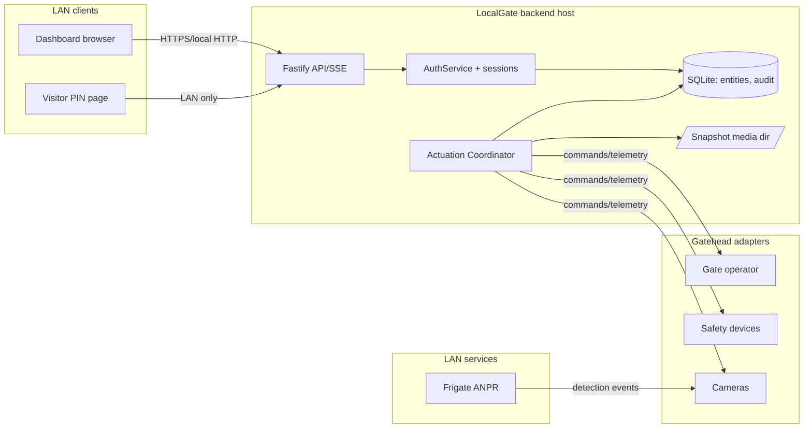

# P0 Threat Model — LocalGate AI

**Status:** Proposed for P0 review.
**Bound to:** `DOMAIN.md` (entities/state machines), `GATEHEAD.md` (device boundary), `OPENCODE_BUILD_PLAN.md` rev 2.1 (C4, C5, D5).

---

## 1. Trust zones

| Zone | Contents                                                                                                | Trust level                                                                  |
| ---- | ------------------------------------------------------------------------------------------------------- | ---------------------------------------------------------------------------- |
| Z1   | LAN client devices — browser dashboard, phone dashboard, visitor-PIN kiosk page                         | Partially trusted                                                            |
| Z2   | LocalGate backend host (Fastify process + SQLite file + snapshot media dir)                             | High — holds credentials, audit, personal data                               |
| Z3   | Controlled devices / Gatehead adapters (simulated now; operator, photocell, safety edge, cameras later) | Untrusted-ish — hardware owns real state, telemetry can be delayed or absent |
| Z4   | External LAN services (Frigate, Home Assistant)                                                         | Partially trusted — authenticated API, no assumption of integrity            |
| Z5   | Human maintenance operator (site owner)                                                                 | Trusted for config, but all actions audited                                  |

No public internet exposure is designed or assumed. `C3` re-verification: after staging, no _outbound_ require-cloud dependency in the hot path; P6 tests verify the claim rather than assume it.

## 2. Data-flow diagram (protection boundaries)

## 3. Assets

| Asset                                                 | Sensitivity                              | Notes                                                                                                                                                  |
| ----------------------------------------------------- | ---------------------------------------- | ------------------------------------------------------------------------------------------------------------------------------------------------------ |
| Operator credentials (scrypt hashes)                  | High                                     | Brute-force targets; parameters per DEC-008                                                                                                            |
| Visitor PINs (scrypt hashes)                          | High                                     | Short-lived, guessable space → rate limiting is the compensating control                                                                               |
| Personal data: plate images/detections, visit history | High (GDPR-class even if not an EU site) | Data-minimization is a design decision, not a compliance checkbox                                                                                      |
| Audit/decision integrity                              | High                                     | Append-only; tampering would undermine incident reconstruction                                                                                         |
| Gate/actuation integrity + safety                     | High                                     | A spurious or blind "open" is a physical-security win for an attacker                                                                                  |
| Availability                                          | Medium                                   | A stuck-locked gate annoys; a stuck-open one is a hole — bias toward fail-_closed_ (contact-reported observation) rather than auto-open on uncertainty |

## 4. Actors

| Actor                                                         | Capability                               | Threat posture                                                 |
| ------------------------------------------------------------- | ---------------------------------------- | -------------------------------------------------------------- |
| Homeowner/admin (Z5)                                          | Full config, audit, credentials          | Insider; mitigated by audit + dual-approach (not modeled here) |
| Guest with issued credential/PIN (Z1)                         | Uses PIN endpoint                        | Enumeration, replay within validity window                     |
| LAN adversary (Z1, attacker-controlled device on the network) | Packet capture, endpoint probing, replay | Primary modeled attacker                                       |
| Compromised LAN device (Z1/Z4)                                | Valid-ish credentials, session theft     | Elevated LAN adversary                                         |
| Physical intruder at the gate (outside Z3)                    | Tails vehicles, sees indicator lights    | Physical, partially outside model until hardware specs arrive  |
| Vendor service (Z4)                                           | Misconfiguration, downgrade              | Feed-poisoning of ANPR detections                              |

## 5. Threat register (STRIDE-lite, mapped to DESIGN doc entities)

| ID   | Threat                                             | Target                            | Mitigation (design refs)                                                                                                             |
| ---- | -------------------------------------------------- | --------------------------------- | ------------------------------------------------------------------------------------------------------------------------------------ |
| T-01 | Credential stuffing on visitor-PIN endpoint        | `VisitorCredential`, Z1           | Rate limit + lockout per device/IP (D5); constant-time invalid response; no user-existence oracle                                    |
| T-02 | PIN replay inside validity window                  | `VisitorCredential`               | `max_uses` + per-entry `GateSession` uniqueness; revocation supersedes future attempts                                               |
| T-03 | Enumeration of valid PINs from response timing     | `VisitorCredential`               | Anti-enumeration policy documented; latency shaping where possible                                                                   |
| T-04 | Session hijack via LAN HTTP                        | Z1→Z2                             | HTTPS with internal-CA or self-signed cert by default; HTTP bind bound to localhost by default; cookie `HttpOnly`, `SameSite=Strict` |
| T-05 | CSRF against dashboard actuation                   | Z2                                | Same-origin default + `SameSite=Strict`; explicit CSRF token per C2's guaranteed same-origin; not bypassable by "it's LAN"           |
| T-06 | Blind/spurious actuation on stale safety data      | `SafetyDevice`                    | Amd 2.1 D5: reject dispatch while stale/unknown; telemetry freshness surfaced in hold-to-confirm panel                               |
| T-07 | Audit tampering/drop                               | `AuditRecord`                     | Append-only (D2), forward-only migrations, JSONL export; correction-of records, never rewrite/deletes                                |
| T-08 | Plate/image data creep                             | `Detection`, `PlateAuthorization` | Retention policy config; no raw frames by default (`GATEHEAD.md` §5); export/debug only through config                               |
| T-09 | Feed poisoning from Frigate/cloud ANPR (downgrade) | `AnprProvider`                    | Confidence threshold from site config; no auto-admitted plate without a decision row; faults for low-confidence rows                 |
| T-10 | Denial-of-service via cert/MQ/process abuse        | Z2                                | Non-focus; single-family site; basic request-size caps + audit logging; _not designed_ for hostile multi-tenant LAN                  |
| T-11 | Supply-chain of node modules                       | Z2 package install                | 40-dep budget (D1), transitive-dep report in P1, lockfile committed from P1 forward                                                  |
| T-12 | Snapshot evidence loss during offline window       | FS `SnapshotRef`                  | `{phase:'unavailable'}` recorded honestly (F-05), never fabricated                                                                   |
| T-13 | Localhost process privilege creep                  | Z2                                | Process runs minimal-privilege service account (documented in C2 setup docs P4)                                                      |
| T-14 | Physical tampering with gate controller            | Z3                                | Out of digital scope; recorded as known limitation until hardware commissioning (P6)                                                 |
| T-15 | Insider credential sharing (guest PIN forwarded)   | `VisitorCredential`               | Accept by design; mitigates impact via `max_uses` + expiry; documented[len=0]                                                        |

## 6. Excluded / out-of-scope threats (recorded, with reason)

- **Nation-state / targeted implant on the host OS** — out of model scope for a self-hosted family site; hardening is generic OS hygiene, not a design deliverable.
- **Hardware physical bypass** (cutting cables, soldering the controller) — accepted as a real risk; not mitigable in software; `C4 prevents claims of security the hardware cannot deliver.`
- **Full ANPR evasion** (masks, fake plates) — acknowledged; an ANPR pass is _advisory_ and always yields a decision row, never silent bypass. Retested when P5 brings real model behavior.
- **Cloud services** — by design C1 makes them absent, so nothing to model.

## 7. Data protection principles applied

- Passwords and PINs stored one-way (scrypt, per-record salt, params documented); no reversible encryption of secrets-at-rest.
- Plate images retained under configured policy; blowups of raw frames (privacy) default-off, configurable, and everything written through clear-source `imported` rows.
- Audit payloads store a digest (`payload_digest`), not copy of sensitive context; interpretation machine-readable via AGENTS-labelled fields in DB, never beyond digest.
- Every exported dataset (P6 `RELEASE.md` checklist) includes a "what's in the export" statement, so release gates audit privacy, too.

## 8. Verification binding to phases

| Control                                                       | Verified in                                                           |
| ------------------------------------------------------------- | --------------------------------------------------------------------- |
| Auth/session, session theft                                   | P4                                                                    |
| PIN endpoint rate limiting + lockout                          | P4                                                                    |
| Audit append-only & forward-only migration                    | P4                                                                    |
| Data retention / minimization behaviors                       | P4, rechecked P6                                                      |
| Fail-closed safety (stale warnings)                           | P2 simulator conformance, re-checked in P5 live trial, released in P6 |
| Dependency/supply chain (lockfile, revised transitive report) | P1 setup, ongoing review per plan                                     |
